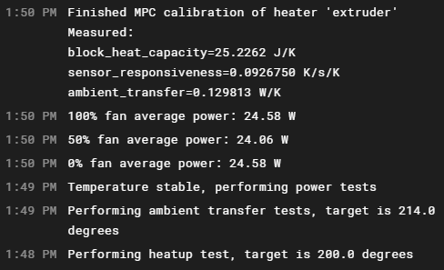
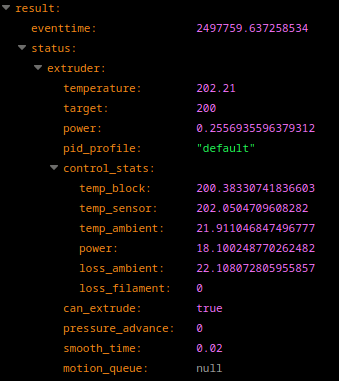

# Model Predictive Control

Model Predictive Control (MPC) is an advanced temperature control method that offers an alternative to traditional PID control. MPC leverages a system model to simulate the temperature of the hotend and adjusts the heater power to align with the target temperature.  

Unlike reactive methods, MPC operates proactively, adjusting in anticipation of temperature fluctuations. It utilizes a model of the hotend, considering factors such as the thermal masses of the system, heater power, heat loss to ambient air, and fans, and heat transfer into the filament. This model allows MPC to predict the amount of heat energy that will be dissipated from the hotend over a given duration, and it compensates for this by adjusting the heater power accordingly. As a result, MPC can accurately calculate the necessary heat energy input to maintain a steady temperature or to transition to a new temperature.

MPC offers several advantages over PID control:

- **Faster and more responsive temperature control:** MPC’s proactive approach allows it to respond more quickly and accurately to changes in temperature from fans or flow rate changes. 
- **Broad functionality with single calibration:** Once calibrated, MPC functions effectively across a wide range of printing temperatures.  
- **Simplified calibration process:** MPC is easier to calibrate compared to traditional PID control. 
- **Compatibility with all hotend sensor types:** MPC works with all types of hotend sensors, including those that produce noisy temperature readings.
- **Versatility with heater types:** MPC performs well with standard cartridge heaters and PTC heaters.
- **Effective for high and low flow hotends:** Regardless of the flow rate of the hotend, MPC maintains effective temperature control.     

> [!CAUTION]
> This feature controls the portions of the 3D printer that can get very hot. All standard Kalico warnings apply. Please report all issues and bugs to [GitHub](https://github.com/KalicoCrew/kalico/issues) or [Discord](Contact.md#discord).

# Basic Configuration

To use MPC as the temperature controller for the extruder use the following basic configuration block.

```
[extruder]
control: mpc
heater_power: 50  
cooling_fan:
filament_diameter: 1.75
filament_density: 1.20
filament_heat_capacity: 1.8 
```

- `control: mpc`  
  *Required*  
  The temperature control method.
  
- `heater_power: 50`  
  *Required*   
  The nameplate heater power in watts.  
  The power of a PTC heater drops as it heats up. For such a heater give the
  power at two or more temperatures as `temperature:power` pairs instead, see
  [PTC Heater Power](#ptc-heater-power).
  
- `cooling_fan:`  
  _Default Value: Nothing_  
  The fan that is cooling extruded filament and the hotend. Default is no fan so 
  there will be no fan taken into account for controlling the heater.
  Specifying "fan" will automatically use the part cooling fan. Any other fan
  section can also be used, e.g. `cooling_fan: fan_generic <fan_name>`.
  
- `filament_diameter: 1.75`  
  _Default Value: 1.75 (mm)_  
  This is the filament diameter.  
  
- `filament_density: 1.20`   
  _Default Value: 1.20 (g/cm^3)_  
  This is the material density of the filament being printed.
  
- `filament_heat_capacity: 1.80`  
  _Default Value: 1.80 (J/g/K)_  
  This is the material specific heat capacity of the filament being printed.  

## Optional Config Parameters

These can be specified in the config but should not need to be changed from the default values for most users.

- `maximum_retract:`  
  _Default Value: 2.0 (mm)_  
  This value clamps how much the extruder is allowed to go backwards in a single period during MPC FFF calculations. This lets the filament power go negative and add a small amount of energy to the system.  

- `target_reach_time:`  
  _Default Value: 2.0 (sec)_  
 
- `smoothing:`  
  _Default Value: 0.83_  
  This parameter affects how quickly the model learns and it represents the ratio of the difference between the measured and the modelled sensor temperature that is applied per second. A value of 1.0 represents no smoothing used in the model.  
  
- `min_ambient_change:`  
  _Default Value: 1.0 (deg C/s)_  
  Larger values of `min_ambient_change` will result in faster convergence but will also cause the simulated ambient temperature to flutter somewhat chaotically around the ideal value.  
  
- `steady_state_rate:`  
  _Default Value: 0.5 (deg C/s)_  
  The simulated ambient temperature is only adjusted while the heater output is not at its limit or the modelled block temperature changes slower than this rate.  

- `filament_temperature_source:`  
  _Default Value: ambient_  
  The temperature of the filament entering the hotend, used by filament feed forward. Either `ambient` (the simulated ambient temperature), `sensor` (the `ambient_temp_sensor`) or a fixed temperature in deg C. It can be changed at runtime with `MPC_SET ... FILAMENT_TEMP=`.  
  
- `disturbance_estimator:`  
  _Default Value: ambient_  
  How MPC accounts for what its model gets wrong. `ambient` adjusts the simulated ambient temperature. `power` estimates the unmodelled heat loss directly, see [Power Disturbance Estimator](#power-disturbance-estimator).  

- `disturbance_gain:`  
  _Default Value: 1.0_  
  Only used with `disturbance_estimator: power`. Larger values learn an unmodelled heat loss faster but react more to sensor noise and to short disturbances.  

- `ambient_temp_sensor: temperature_sensor <sensor_name>`  
  _Default Value: MPC ESTIMATE_  
  It is recommended not to specify this parameter and let MPC estimate the ambient temperature. This is used for initial state temperature and calibration but not for actual control.
  Any temperature sensor could be used, but the sensor should be in proximity to the hotend or measuring the ambient air surrounding the hotend.  

## PTC Heater Power

The power of a PTC style heater decreases as the heater gets hotter. MPC can take this into account when `heater_power` is given as a list of `temperature:power` pairs:

```
[extruder]
control: mpc
heater_power: 180:72, 240:65, 300:60
```

The power between the listed temperatures is interpolated. Below the lowest and above the highest listed temperature the nearest two points are extended in a straight line, limited to between half the lowest and twice the highest listed power. Two points, one near the lowest and one near the highest printing temperature, are sufficient; more points can be listed if the heater is known to be less linear.

Run `MPC_CALIBRATE` again after changing `heater_power`. With a single power value the calibration has to attribute the extra power a cold PTC heater delivers to a smaller heater block, which shows as a larger model fit error during calibration and as overshoot after heating up.

Some common PTC heaters are given below for reference. If your heater is not listed the manufacturer should be able to provide a temperature and power curve. If only a single value is used, set it to the power at the normal print temperature for the printer.

| Heater Temp (C) | Rapido 2 (W) | Rapido 1 (W) | Dragon Ace old (W) | Dragon Ace new (W) | Revo 40 (W) |Revo 60 (W) |
|:---------------:|:------------:|:------------:|:------------------:|:------------------:|:-----------:|:----------:|
| 180             | 72           | 52           | 51                 | 66                 | 30          |45          |
| 200             | 70           | 51           | 48                 | 63                 | 29          |44          |
| 220             | 67           | 50           | 46                 | 60                 | 28          |43          |
| 240             | 65           | 49           | 44                 | 58                 | 28          |42          |
| 260             | 64           | 48           | 43                 | 55                 | 27          |40          |
| 280             | 62           | 47           | 41                 | 53                 | 27          |39          |
| 300             | 60           | 46           | 39                 | 51                 | 26          |38          |

For example, a Rapido 2 would be configured with `heater_power: 180:72, 300:60`.

## Filament Feed Forward Configuration

The filament feed forward (FFF) feature allows MPC to look forward and see changes in extrusion rates which could require more or less heat input to maintain target temperature. This feature substantially improves the accuracy and responsiveness of the model during printing. It is enabled by default and can be defined in more detail with the `filament_density` and `filament_heat_capacity` config parameters. The default values are set to cover a wide range of standard materials including ABS, ASA, PLA, PETG. 

 FFF parameters can be set, for the printer session, via the `MPC_SET` G-Code command:  

`MPC_SET HEATER=<heater> [FILAMENT_DIAMETER=<value>] [FILAMENT_DENSITY=<value>] [FILAMENT_HEAT_CAPACITY=<value>] [FILAMENT_TEMP=<sensor|ambient|<value>>]`

- `HEATER`:  
  Only extruder is supported
  
- `FILAMENT_DIAMETER`:  
  Filament diameter in mm
  
- `FILAMENT_DENSITY`:  
  Filament density in g/cm^3
  
- `FILAMENT_HEAT_CAPACITY`:  
  Filament heat capacity in J/g/K
  
- `FILAMENT_TEMP`:  
  This can be set to either `sensor`, `ambient`, or a set temperature value. FFF will use the specific energy required to heat the filament and the power loss will be calculated based on the temperature delta.  

For example, updating the filament material properties for ASA would be:   

```
MPC_SET HEATER=extruder FILAMENT_DENSITY=1.07 FILAMENT_HEAT_CAPACITY=1.7  
```

## Measuring The Filament Heat Capacity

The specific heat of a filament is rarely published, varies between blends of the same polymer and changes with temperature, which is why the tables below can only give ranges. The value MPC needs can be measured on the printer instead:

`MPC_CALIBRATE_FILAMENT HEATER=<heater> [FLOW_RATES=<list>] [MEASURE_TIME=<seconds>] [SETTLE_TIME=<seconds>] [FILAMENT_TEMP=<temperature>]`

- `HEATER=<heater>`:  
  The heater of the active extruder.  

- `FLOW_RATES=<list>`:  
  _Default Value: 5,10 (mm^3/s)_  
  The flow rates to extrude at. Use flow rates that the hotend melts comfortably at the chosen temperature.  

- `MEASURE_TIME=<seconds>`:  
  _Default Value: 20_  
  The time over which the heater power is measured at each flow rate. A longer time gives a more repeatable result and uses more filament.  

- `SETTLE_TIME=<seconds>`:  
  _Default Value: 8_  
  The time to extrude at a flow rate before the measurement starts.  

- `FILAMENT_TEMP=<temperature>`:  
  _Default Value: the `ambient_temp_sensor` if configured, 25 otherwise, or the fixed `filament_temperature_source`_  
  The temperature of the filament entering the hotend, e.g. when it is fed from a dryer or through a heated chamber.  

To run the measurement:

1. Set `filament_diameter` and `filament_density` (or `MPC_SET ... FILAMENT_DENSITY=`) for the loaded filament. The density does not have to be exact: an error in the density is compensated by the measured heat capacity.
2. Move the nozzle to where filament can be extruded freely and heat the extruder to the printing temperature of the filament.
3. Run `MPC_CALIBRATE_FILAMENT HEATER=extruder`.

The routine measures the heater power needed to hold the temperature without extruding, then while extruding at each flow rate, and once more without extruding. The additional power divided by the amount of filament and the temperature rise is the heat capacity. Because the controller compensating for a wrong amount of filament heating disturbs the measurement, the measurement is repeated with the improved value, up to three times, until the result changes by less than 7%.

A measurement takes two to five minutes and roughly 0.2 to 0.5m of 1.75mm filament with the default settings, depending on how many repetitions are needed. The result is reported together with the `MPC_SET` command that restores it and is used until the next restart:

```
Finished MPC filament calibration of heater 'extruder'
Measured:
  5.0 mm^3/s: 2.21 W, 1.890 J/g/K
  10.0 mm^3/s: 4.35 W, 1.858 J/g/K
filament_heat_capacity=1.865 [J/g/K] at filament_density=1.250 [g/cm^3]
The value is used until the next restart. To use it for this filament again:
MPC_SET HEATER=extruder FILAMENT_DENSITY=1.250 FILAMENT_HEAT_CAPACITY=1.865
```

Store the values per filament, e.g. in the filament table of the [macro below](#setting-fff-parameters-from-the-slicer) or in the filament start G-code of the slicer.

> [!NOTE]
> The measured value is the effective heat taken up by the filament in this hotend. It includes any error in `heater_power`, and a hotend that does not fully heat the filament at a high flow rate gives a lower value at that flow rate. Values that drop noticeably from one flow rate to the next mean the higher flow rate is beyond what the hotend melts well.
>
> In simulation the result is within about 10% of the true value with the default settings, and within about 5% with `disturbance_estimator: power` or `MEASURE_TIME=30`.

## Filament Physical Properties

MPC works best knowing how much energy (in Joules) it takes to heat 1mm of filament by 1°C. The material values from the tables below have been curated from popular filament manufacturers and material data references. These values are sufficient for MPC to implement the FFF feature and are good starting points for [measuring the heat capacity](#measuring-the-filament-heat-capacity) of a specific filament. 

### Common Materials

| Material | Density [g/cm³] | Specific heat [J/g/K] |
| -------- |:---------------:|:---------------------:|
| PLA      | 1.25            | 1.8 - 2.2             |
| PETG     | 1.27            | 1.7 - 2.2             |
| PC+ABS   | 1.15            | 1.5 - 2.2             |
| ABS      | 1.06            | 1.25 - 2.4            |
| ASA      | 1.07            | 1.3 - 2.1             |
| PA6      | 1.12            | 2 - 2.5               |
| PA       | 1.15            | 2 - 2.5               |
| PC       | 1.20            | 1.1 - 1.9             |
| TPU      | 1.21            | 1.5 - 2               |
| TPU-90A  | 1.15            | 1.5 - 2               |
| TPU-95A  | 1.22            | 1.5 - 2               |

### Common Carbon Fiber Filled Materials

| Material                                     | Density [g/cm³] | Specific heat [J/g/K] |
| -------------------------------------------- |:---------------:|:---------------------:|
| ABS-CF                                       | 1.11            | ^                     |
| ASA-CF                                       | 1.11            | ^                     |
| PA6-CF                                       | 1.19            | ^                     |
| PC+ABS-CF                                    | 1.22            | ^                     |
| PC+CF                                        | 1.36            | ^                     |
| PLA-CF                                       | 1.29            | ^                     |
| PETG-CF                                      | 1.30            | ^                     |  

^ Use the specific heat from the base polymer  

# Calibration

The MPC default calibration routine takes the following steps:

> 1. Cool to ambient: The calibration routine needs to know the approximate ambient temperature and waits until the hotend temperature stabilises and stops decreasing relative to ambient.
> 2. Heat past the target at full power, then switch the heater off for a few seconds: The whole temperature record, including the way the sensor overshoots and turns around once the heater is off, is fitted to the MPC model. This determines the heat capacity of the heater block and the responsiveness of the sensor.
> 3. Hold temperature while measuring ambient heat-loss: At this point enough is known for the MPC algorithm to engage. The calibration routine holds the target temperature while ambient heat-loss is measured without the fan and, if a `cooling_fan` is specified, at each requested fan speed (see [Fan Measurement](#fan-measurement)). The model from step 2 is then refined using the measured heat-loss.
> 4. The MPC calibration routine creates the appropriate model constants. At this time the model parameters are temporary and not yet saved to the printer configuration.  

The MPC calibration routine must be run for each heater, to be controlled by MPC, in order to determine the model parameters. For an MPC calibration to be successful an extruder must be able to reach 200C. Calibration is performed with the following G-code command.

`MPC_CALIBRATE HEATER=<heater> [TARGET=<temperature>] [FAN_BREAKPOINTS=<value>] [FAN_SPEEDS=<list>] [FAN_SETTLE_TIME=<seconds>] [MEASURE_TIME=<seconds>]`  

- `HEATER=<heater>`:  
  The extruder heater to be calibrated.  
  
- `TARGET=<temperature>`:  
  _Default Value: 200 (deg C)_  
  Sets the calibration temperature. The default of 200C is a good target for the extruder. MPC calibration is temperature independent, so calibrating the extruder at higher temperatures will not necessarily produce better model parameters. This is an area of exploration for advanced users.  
  
- `FAN_BREAKPOINTS=<value>`:  
  _Default Value: 3_  
  Sets the number of evenly spaced fan setpoints to test during calibration. An arbitrary number of breakpoints can be specified e.g. 7 breakpoints would result in (0, 16%, 33%, 50%, 66%, 83%, 100%) fan speeds.  

- `FAN_SPEEDS=<list>`:  
  _Default Value: not set_  
  A comma-separated list of the fan speeds (0 to 1) to test instead of evenly spaced breakpoints, e.g. `FAN_SPEEDS=0.1,0.2,0.3,0.5,1`. The measurement without fan is always included. Most fans change the heat loss the most at the low end of their range, so it is recommended to test the lowest fan speed normally used, one or two speeds around it, and 100%.  

- `FAN_SETTLE_TIME=<seconds>`:  
  _Default Value: 10_  
  The time to wait after changing the fan speed before the heat loss is measured.  

- `MEASURE_TIME=<seconds>`:  
  _Default Value: 15_  
  The time over which each heat loss measurement is taken.  
  
Default calibration of the hotend with seven fan breakpoints:  
```
MPC_CALIBRATE HEATER=extruder FAN_BREAKPOINTS=7
```

Calibration with fan speeds concentrated at the low end:  
```
MPC_CALIBRATE HEATER=extruder FAN_SPEEDS=0.1,0.2,0.3,0.5,0.75,1
```

## Fan Measurement

The part cooling fan is switched off for the heat-up and then stepped through the requested speeds while MPC holds the target temperature. Each fan speed takes about 25 seconds with the default settings.

The heat loss at each speed is measured as the energy supplied by the heater minus the energy that went into changing the block temperature, so the temperature does not have to be perfectly steady. Each result is handed to the controller right away. The controller therefore already compensates for the fan speeds measured so far and only has to cope with the additional loss of the next step.

The calibration does not get stuck when the fan is stronger than the heater:

- If the temperature drops more than 8°C below the target the fan is switched off, the temperature is allowed to recover and the fan speed is approached again through an intermediate speed. The intermediate speed is added to the result.
- If the heater needs more than 95% of its power to hold the temperature, or the temperature cannot be held even after approaching in small steps, the remaining higher fan speeds are not tested. The heat loss measured at the highest tested fan speed is then used for all higher fan speeds.

> [!NOTE]
> The heat loss caused by the fan depends on where the air stream goes. If the fan compensation appears to be off while printing, run the calibration with the nozzle a few millimeters above the bed, where the air is deflected in the same way as during a print.

## Calibration Results

After successful calibration the method will generate the key model parameters into the log for future reference.  



The calibration also reports how well the model matches the recorded heat-up, e.g. `Model fitted to 310 samples, error 0.25 degrees RMS`. An error of well under one degree is typical. A large error means that the heater did not behave like the model during the test, for example because `heater_power` is far from the real heater power, the part cooling fan was running, or the hotend was disturbed.

> [!NOTE]
> Kalico versions before the model fit was introduced calculated `sensor_responsiveness` incorrectly (the result was always close to 0.1, whatever the sensor) and `block_heat_capacity` could be off by 10-25%. Heaters calibrated with such a version should be calibrated again. The symptoms of the old values are a hotend that creeps towards the target for a long time after heating up and slow recovery from fan speed changes.

A `SAVE_CONFIG` command is then required to commit these calibrated model parameters to the printer config or the user can manually update the values. The _SAVE_CONFIG_ block should then look like: 

```
#*# <----------- SAVE_CONFIG ----------->
#*# DO NOT EDIT THIS BLOCK OR BELOW. The contents are auto-generated.
#*# [extruder]
#*# control = mpc
#*# block_heat_capacity = 19.8312
#*# sensor_responsiveness = 0.228104
#*# ambient_transfer = 0.155082
#*# fan_ambient_transfer = 0.155082, 0.20156, 0.216441
```

When the tested fan speeds are not evenly spaced from 0% to 100% each value is stored together with its fan speed:

```
#*# fan_ambient_transfer = 0:0.155082, 0.1:0.157341, 0.2:0.171932, 0.3:0.184502, 0.5:0.20156, 1:0.216441
```

> [!NOTE]
> If the [extruder] section is in a .cfg file other than printer.cfg the `SAVE_CONFIG` command may not be able to write the calibration parameters and klippy will provide an error. 

These model parameters are not suitable for pre-configuration or are not explicitly determinable. Advanced users could tweak these post calibration based on the following guidance: Slightly increasing these values will increase the temperature where MPC settles and slightly decreasing them will decrease the settling temperature.  

- `block_heat_capacity:`  
  Heat capacity of the heater block in (J/K).  
  
- `ambient_transfer:`  
  Heat transfer from heater block to ambient in (W/K).  
  
- `sensor_responsiveness:`  
  A single constant representing the coefficient of heat transfer from heater block to sensor and heat capacity of the sensor in (K/s/K). The inverse is the time constant of the sensor in seconds: with a value of 0.25 the sensor needs about 4 seconds to follow most of a change in block temperature.  
  
- `fan_ambient_transfer:`  
  Heat transfer from heater block to ambient with the fan enabled in (W/K). Either a list of values for evenly spaced fan speeds from 0% to 100%, or a list of `fan speed:value` pairs with the fan speed given as 0 to 1. Values between the listed fan speeds are interpolated.  
  
# Support Macros

## Temperature Wait

The following macro can be used to replace `M109` hotend temperature set and `M190` bed temperature set G-code commands with a macro utilizing `temperature_wait` G-codes. This can be utilized in systems where the sensor temperature takes an extended time to converge on the set temperature. 
> [!NOTE]
> This behaviour occurs because MPC controls the modelled block temperature and not the hotend temperature sensor. A sensor that responds slowly (a low `sensor_responsiveness`) is still catching up when the block has already reached the set temperature. However, the Kalico system performs actions based on the sensor temperature only which can lead to undesirable delays in print actions with stock `M109` and `M190` commands.
>
> If the delay is long, first make sure the heater was calibrated with a current Kalico version: an incorrect `sensor_responsiveness` makes MPC reduce the heater power before the block has really reached the set temperature, which looks the same.

```
[gcode_macro M109] # Wait Hotend Temp
rename_existing: M109.1
gcode:
    #Parameters
    

    M104 {'%s%s' % (p, params[p])}  # Set hotend temp
    
        TEMPERATURE_WAIT SENSOR=extruder MINIMUM={s-2} MAXIMUM={s+5}   # Wait for hotend temp (within n degrees)
    


[gcode_macro M190] # Wait Bed Temp
rename_existing: M190.1
gcode:
    #Parameters
    

    M140 {'%s%s' % (p, params[p])}   # Set bed temp
    
        TEMPERATURE_WAIT SENSOR=heater_bed MINIMUM={s-2} MAXIMUM={s+5}  # Wait for bed temp (within n degrees)
    
```

### Setting FFF Parameters From The Slicer

This macro will set FFF parameters automatically when the material type is passed from the slicer. 

```ini
[gcode_macro _SET_MPC_MATERIAL]
description: Set heater MPC parameters for a given material
variable_filament_table:
    ## Update this table to adjust material settings
    {
        ## ( density, heat capacity )  # suggested heat capacity range
        "PLA"       : ( 1.25, 2.20 ),  # 1.80 - 2.20
        "PETG"      : ( 1.27, 2.20 ),  # 1.70 - 2.20
        "PC+ABS"    : ( 1.15, 2.20 ),  # 1.50 - 2.20
        "ABS"       : ( 1.06, 2.40 ),  # 1.25 - 2.40
        "ASA"       : ( 1.07, 2.10 ),  # 1.30 - 2.10
        "PA6"       : ( 1.12, 2.50 ),  # 2.00 - 2.50
        "PA"        : ( 1.15, 2.50 ),  # 2.00 - 2.50
        "PC"        : ( 1.20, 1.90 ),  # 1.10 - 1.90
        "TPU"       : ( 1.21, 2.00 ),  # 1.50 - 2.00
        "TPU-90A"   : ( 1.15, 2.00 ),  # 1.50 - 2.00
        "TPU-95A"   : ( 1.22, 2.00 ),  # 1.50 - 2.00
        "ABS-CF"    : ( 1.11, 2.40 ),  # 1.25 - 2.40
        "ASA-CF"    : ( 1.11, 2.10 ),  # 1.30 - 2.10
        "PA6-CF"    : ( 1.19, 2.50 ),  # 2.00 - 2.50
        "PC+ABS-CF" : ( 1.22, 2.20 ),  # 1.50 - 2.20
        "PC+CF"     : ( 1.36, 1.90 ),  # 1.10 - 1.90
        "PLA-CF"    : ( 1.29, 2.20 ),  # 1.80 - 2.20
        "PETG-CF"   : ( 1.30, 2.20 ),  # 1.70 - 2.20
    }
gcode:
    
    
    

    
        

        RESPOND PREFIX=🔥 MSG="Configured {heater} MPC for {material}. Density: {density}, Heat Capacity: {heat_capacity}"
    
        
        

        RESPOND PREFIX=🔥 MSG="Unknown material '{material}', using default mpc parameters for {heater}"
    

    MPC_SET HEATER={heater} FILAMENT_DENSITY={density} FILAMENT_HEAT_CAPACITY={heat_capacity}
```

The slicer must be configured to pass the current material type to your `PRINT_START` macro. For PrusaSlicer you should add the following parameter line to `print_start` in the Start G-Code section:

```
MATERIAL=[filament_type[initial_extruder]]
```

The print_start line, in PrusaSlicer, would look like:

```
start_print MATERIAL=[filament_type[initial_extruder]] EXTRUDER_TEMP={first_layer_temperature[initial_extruder]} BED_TEMP={first_layer_bed_temperature[initial_extruder]} CHAMBER_TEMP={chamber_temperature}
```

Then, in your `PRINT_START` macro include the following macro call:

```
_SET_MPC_MATERIAL MATERIAL={params.MATERIAL}
```

# Real-Time Model State

The real-time temperatures and model states can be viewed from a browser by entering the following local address for your computer.

```
https://192.168.xxx.xxx:7125/printer/objects/query?extruder
```



The `control_stats` section of the output contains:

- `temp_block`, `temp_sensor`, `temp_ambient`: the modelled block, sensor and ambient temperatures.
- `power`: the heater power requested by MPC in watts.
- `loss_ambient`, `loss_filament`: the modelled heat loss to the ambient air (including the fan) and into the filament in watts.
- `disturbance`: the unmodelled heat loss in watts estimated with `disturbance_estimator: power` (always 0 with the `ambient` estimator).

# EXPERIMENTAL FEATURES

## Power Disturbance Estimator

No model is perfect: the fan curve is measured in still air, the specific heat of the filament is an approximation, and the airflow around the nozzle changes with the part being printed. MPC has to absorb such errors.

By default (`disturbance_estimator: ambient`) MPC does this the way Marlin does, by adjusting its simulated ambient temperature. This works, but it is slow, about 1°C of ambient temperature per second, which corresponds to only around 0.1 W per second. A fan that is not in the model takes minutes to be compensated, and the simulated ambient temperature can end up far away from anything physical.

With `disturbance_estimator: power` MPC estimates the unmodelled heat loss directly, in watts, with gains derived from the calibrated model:

```
[extruder]
control: mpc
disturbance_estimator: power
```

- The ambient temperature is no longer adjusted. It is taken from `ambient_temp_sensor` if one is configured and assumed to be 25°C otherwise. An ambient temperature that differs from this (e.g. a heated chamber) simply becomes part of the estimated heat loss.
- The model is updated with the power the heater really received. Kalico does not send small changes of the heater output to the MCU right away, and the power estimator takes this into account.
- The estimate is frozen while the heater output is at its limit for more than a second (heating up, or more flow than the heater can supply) and cleared when the heater is switched off.

In simulation the power estimator recovers from an error in the model two to five times faster than the ambient estimator, for example from a `filament_heat_capacity` that is 30% off or a fan curve that does not match, and performs the same when the model is accurate. The peak temperature error right after a disturbance is not reduced. It has not yet been validated on a wide range of hardware, which is why it is not the default.

> [!NOTE]
> The power estimator relies on an accurate `sensor_responsiveness` and `block_heat_capacity`. Run `MPC_CALIBRATE` with a current Kalico version before enabling it.

The estimator can be changed at runtime to compare the two on the same print:

`MPC_SET HEATER=<heater> [DISTURBANCE_ESTIMATOR=<ambient|power>] [DISTURBANCE_GAIN=<value>]`

The calibration always uses the `ambient` estimator.

## Bed Heater

Using MPC for bed heater control is functional but the performance is not guaranteed or currently supported.  MPC for the bed can be configured simply.

```
[heater_bed]
control: mpc
heater_power: 400
```

- `control: mpc`  
  *Required*  
  The temperature control method.  
  
- `heater_power: 50`  
  *Required*  
  The nameplate heater power in watts.  
  
- `cooling_fan: fan_generic <fan_name>`  
  _No Default Value_  
  This is the fan cooling the bed. Optional parameter to support bed fans.  

The bed should be able to reach at least 90C to perform calibration with the following G-code. 

`MPC_CALIBRATE HEATER=<heater> [TARGET=<temperature>] [FAN_BREAKPOINTS=<value>] [FAN_SPEEDS=<list>]`  

- `HEATER=<heater>`:  
  The bed heater to be calibrated.  
  
- `TARGET=<temperature>`:  
  _Default Value: 90 (deg C)_  
  Sets the calibration temperature. The default of 90C is a good target for the bed.  
  
- `FAN_BREAKPOINTS=<value>`:  
  _Default Value: 3_  
  Sets the number of fan setpoint to test during calibration.    

Default calibration of the hotend with five fan breakpoints:  
```
MPC_CALIBRATE HEATER=heater_bed FAN_BREAKPOINTS=5
```

These calibrated model parameters need to be saved to the _SAVE_CONFIG_ block manually or by using the `SAVE_CONFIG` command.

## Updating calibration parameters at runtime

Similar to [`SET_HEATER_PID`](G-Codes.md#set_heater_pid), you can update your MPC calibration profile at runtime.

`MPC_SET HEATER=<heater_name> [BLOCK_HEAT_CAPACITY=0.0] [SENSOR_RESPONSIVENESS=0.0] [AMBIENT_TRANSFER=0.0] [FAN_AMBIENT_TRANSFER=0.01,0.02,0.03]`

`FAN_AMBIENT_TRANSFER` accepts the same two formats as the `fan_ambient_transfer` config option, e.g. `FAN_AMBIENT_TRANSFER=0:0.01,0.3:0.02,1:0.03`.

# BACKGROUND

## MPC Algorithm

MPC models the hotend system as four thermal masses: ambient air, the filament, the heater block and the sensor. Heater power heats the modelled heater block directly. Ambient air heats or cools the heater block. Filament cools the heater block. The heater block heats or cools the sensor.  

Every time the MPC algorithm runs it uses the following information to calculate a new temperature for the simulated hotend and sensor:  

- The last power setting for the hotend.  
- The present best-guess of the ambient temperature.  
- The effect of the fan on heat-loss to the ambient air.  
- The effect of filament feedrate on heat-loss to the filament. Filament is assumed to be at the same temperature as the ambient air.  

Once this calculation is done, the simulated sensor temperature is compared to the measured temperature and a fraction of the difference is added to the modelled sensor and heater block temperatures. This drags the simulated system in the direction of the real system. Because only a fraction of the difference is applied, sensor noise is diminished and averages out to zero over time. Both the simulated and the real sensor exhibit the same (or very similar) latency. Consequently, the effects of latency are eliminated when these values are compared to each other. So, the simulated hotend is only minimally affected by sensor noise and latency.   

`smoothing` is the factor applied to the difference between simulated and measured sensor temperature. At its maximum value of 1, the simulated sensor temperature is continually set equal to the measured sensor temperature. A lower value will result in greater stability in MPC output power but also in decreased responsiveness. In Kalico the value is expressed per second and scaled to the sensor update interval, so the default of 0.83 applies roughly 0.41 of the difference on each 0.3 second update.  

No simulation is perfect and, anyway, real life ambient temperature changes. So MPC also maintains a best guess estimate of ambient temperature. When the simulated system is close to steady state the simulated ambient temperature is continually adjusted. Steady state is determined to be when the MPC algorithm is not driving the hotend at its limits (i.e., full or zero heater power) or when it is at its limit but temperatures are still not changing very much - which will occur at asymptotic temperature (usually when target temperature is zero and the hotend is at ambient).  

`steady_state_rate` is used to recognize the asymptotic condition. Whenever the simulated hotend temperature changes at an absolute rate less than steady_state_rate between two successive runs of the algorithm, the steady state logic is applied. Since the algorithm runs frequently, even a small amount of noise can result in a fairly high instantaneous rate of change of hotend temperature. The default is 0.5°C/s.  

When in steady state, the difference between real and simulated sensor temperatures is used to drive the changes to ambient temperature. However, when the temperatures are really close min_ambient_change ensures that the simulated ambient temperature converges relatively quickly. Larger values of min_ambient_change will result in faster convergence but will also cause the simulated ambient temperature to flutter somewhat chaotically around the ideal value. This is not a problem because the effect of ambient temperature is fairly small and short-term variations of even 10°C or more will not have a noticeable effect.  

It is important to note that the simulated ambient temperature will only converge on real world ambient temperature if the ambient heat transfer coefficients are exactly accurate. In practice this will not be the case and the simulated ambient temperature therefore also acts a correction to these inaccuracies.  

Finally, armed with a new set of temperatures, the MPC algorithm calculates how much power must be applied to get the heater block to target temperature in the next two seconds. This calculation takes into account the heat that is expected to be lost to ambient air and filament heating. This power value is then converted to a PWM output.  

## Additional Details

Please refer to the excellent Marlin MPC Documentation for information on the model derivations, tuning methods, and heat transfer coefficients used in this feature.   

# Acknowledgements

This feature is a port of the Marlin MPC implementation, and all credit goes to their team and community for pioneering this feature for open source 3D printing. The Marlin MPC documentation and github pages were heavily referenced and, in some cases directly copied and edited to create this document.  

- Marlin MPC Documentation: [https://marlinfw.org/docs/features/model_predictive_control.html]
- GITHUB PR that implemented MPC in Marlin: [https://github.com/MarlinFirmware/Marlin/pull/23751]
- Marlin Source Code: [https://github.com/MarlinFirmware/Marlin]
